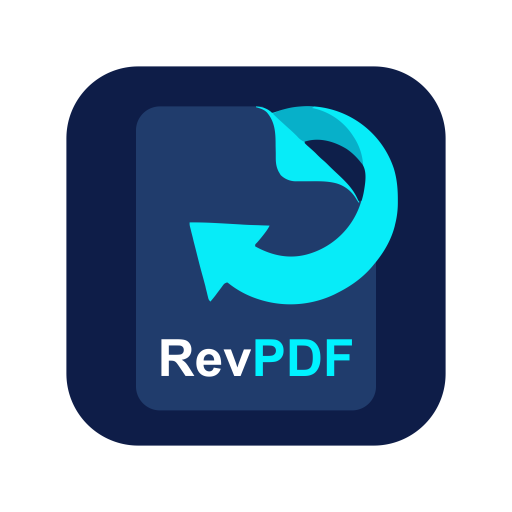
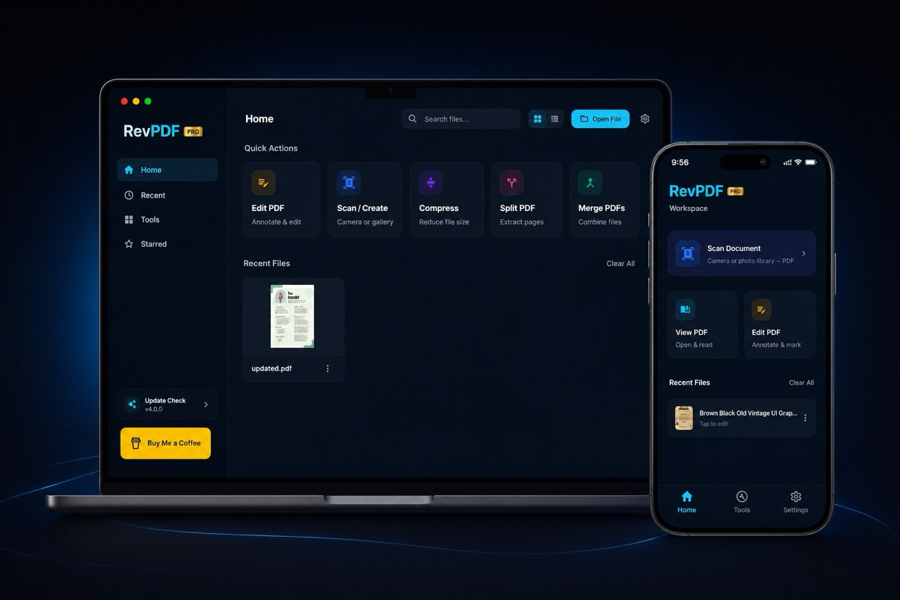

#  revpdf-release

[English](README.md) | 简体中文

**revpdf** 官方发布仓库。revpdf 是一款快速、原生、注重隐私的离线 PDF 编辑器。

[**下载 Android 版**](https://play.google.com/store/apps/details?id=com.revpdf.editor) | [**官方网站**](https://www.revpdf.com)

---

### ✨ 功能特性
- **快速原生**：为性能而打造，编辑器简洁直观。
- **隐私优先**：完全离线处理。无需注册，不上传云端，不追踪数据。
- **高级工具**：
  - ✂️ **拆分**：提取页面或按页码范围拆分。
  - 🤝 **合并**：将多个 PDF 合并为一个。
  - 🗜️ **压缩**：减小文件体积，且不损失画质。
  - 🖼️ **导出为图片**：将 PDF 页面转换为高质量图片。
  - 📄 **图片转 PDF**：用你的照片生成 PDF。
  - ……以及更多功能！

---

### 📥 下载

请在下方选择你的平台，下载最新的稳定版本：

#### 🐧 Linux
- [最新 AppImage](https://github.com/Pawandeep-prog/revpdf-release/releases/latest)

#### 🍎 macOS
- [最新 DMG](https://github.com/Pawandeep-prog/revpdf-release/releases/latest)

#### 🪟 Windows
- [最新测试版（exe）](https://github.com/Pawandeep-prog/revpdf-release/releases/latest)

---

*如需支持或反馈，请访问我们的[官方网站](https://www.revpdf.com)。*
